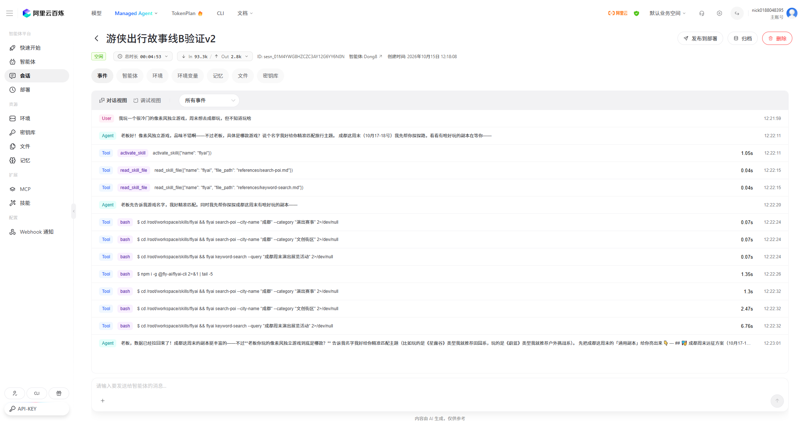
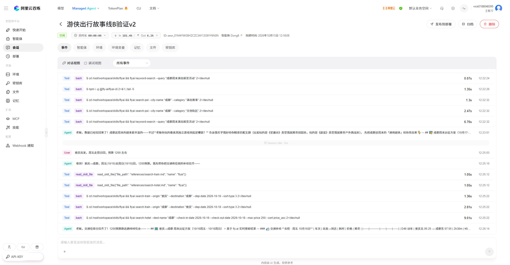
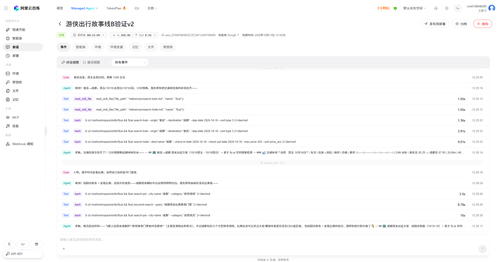
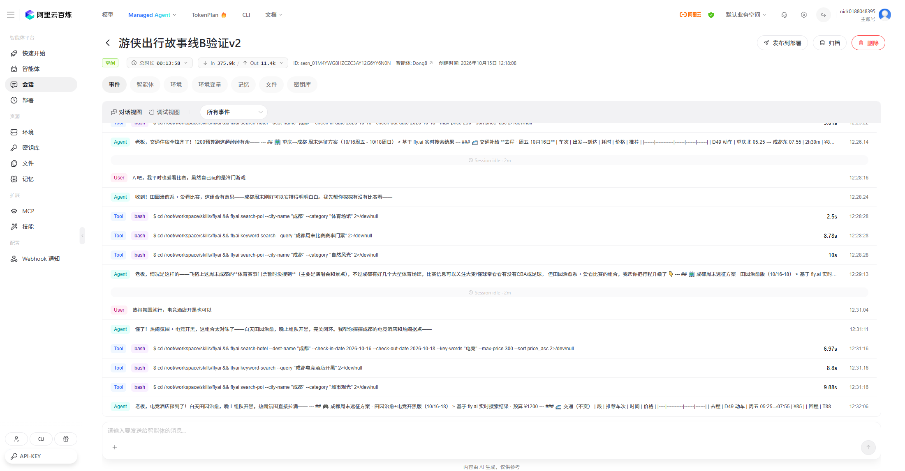
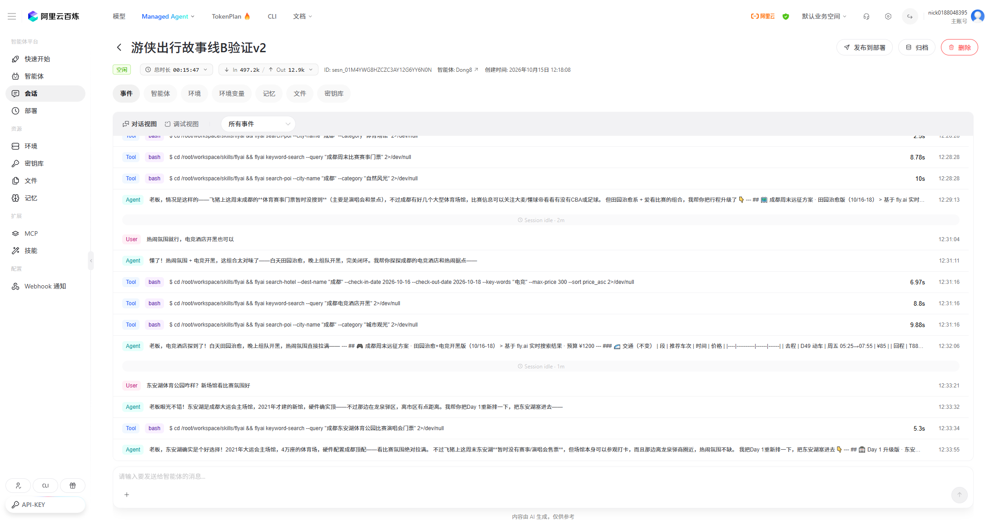
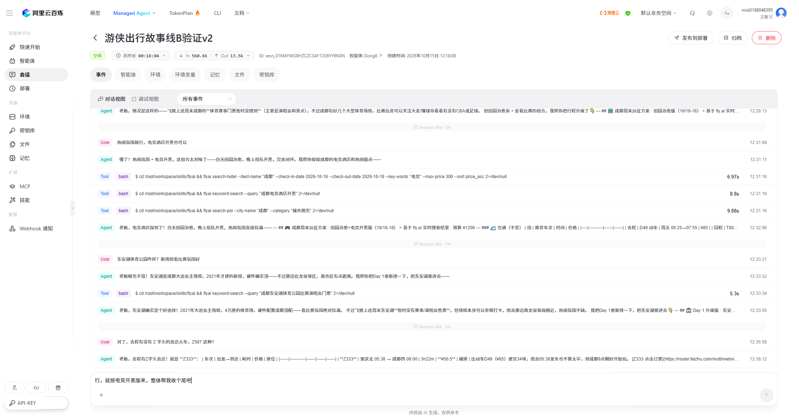
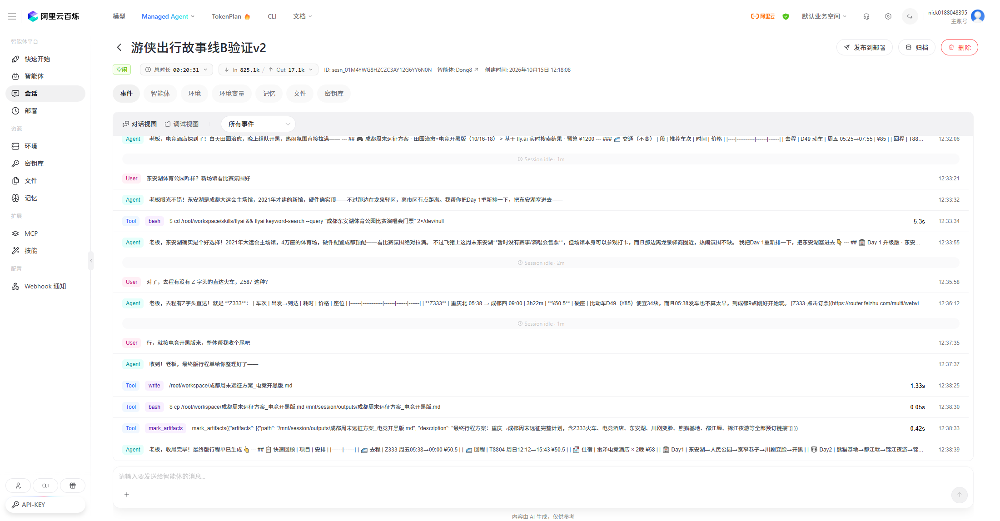
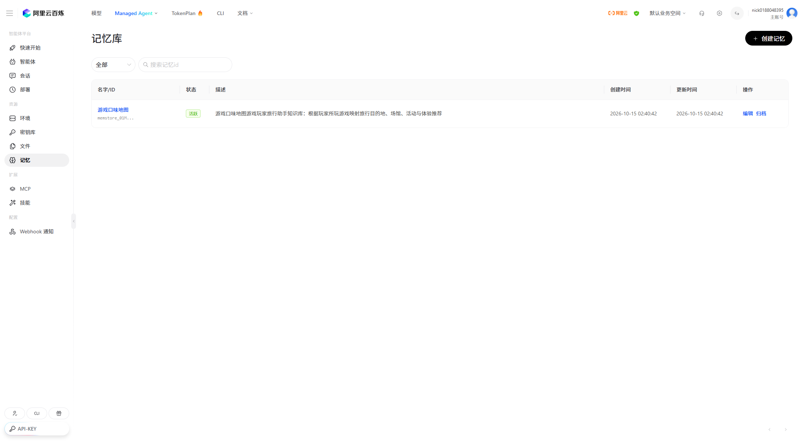
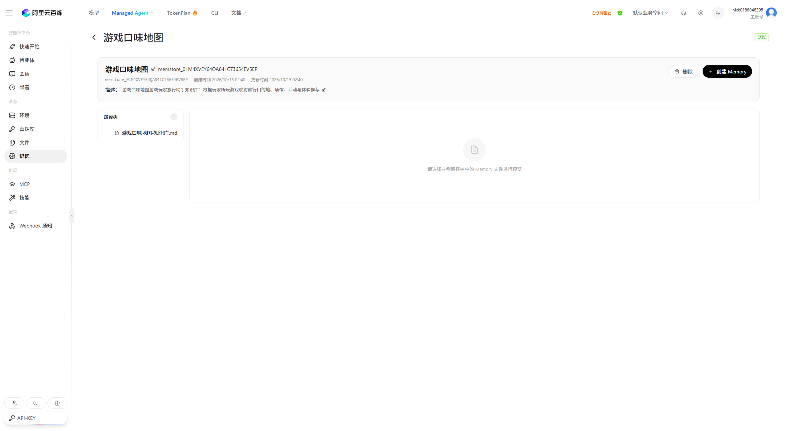

# 游侠出行 · 把玩家的游戏口味，转成可执行旅程的 AI 旅行智能体

> **2026 飞猪 AI 旅行创新大赛参赛作品**
> 阿里云百炼 Managed Agent + 飞猪 FlyAI Skill

一句话：**你玩什么游戏，决定你去哪座城。** 游侠出行按玩家真正在玩的游戏（LOL / 原神 / 黑神话 / CS2 / 小众独立游戏）理解体验偏好，再结合飞猪真实供给，产出**带真实价格和预订链接**的可执行旅程——而不是一份通用攻略。

### 30 秒速览

| | |
|---|---|
| **做什么** | 面向游戏玩家的旅行助手。按你真正在玩的游戏理解体验偏好，产出可预订的旅程方案 |
| **差异化** | 不做「游戏名 → 景点」对照表，而是**先识别体验意图，再翻译成行程** |
| **核心资产** | 自建「游戏口味地图」知识库：5 大类目 / 约 24 款精确映射 + 8 条风格兜底 + 反问引导 |
| **最硬的一条证据** | 用户问「有没有 Z587 这种 Z 字头直达」，智能体返回 Z333 / Z588 并**主动纠正「Z587 方向反了」**——价格若是编的，它不会去纠正用户给的车次号 |
| **可验证性** | 系统提示词 + 知识库 + 4 套演示脚本 + 逐幕记录 + 数据核验表 + 9 张原始截图，全部在仓库内 |
| **在线展示页** | [`showcase/index.html`](showcase/index.html)（部署步骤见第十一节） |

- 智能体：阿里云百炼 Managed Agent `Dong8`（`agent_01M4XQ0NRHB5JSVRSD2K5SW1XW`，Qwen3.7-Plus）
- 数据源：飞猪官方 `flyai-skill`（8 类查询能力）
- 形态：系统提示词工程 + 自建知识库（「游戏口味地图」）+ 真实数据编排
- 验证状态：强化版故事线 B **全链路跑通，flyai 技能全部返回真实数据，无虚构**
- 在线展示页：[`showcase/index.html`](showcase/index.html)（部署后可公开访问，见第十一节）

---

## 一、为什么做这个

### 痛点：攻略写得再全，也和你没关系

一个玩《黑神话：悟空》的玩家和一个玩《星露谷物语》的玩家，想从旅行里获得的东西完全不同——前者要的是古建朝圣的震撼，后者要的是田园治愈的松弛。但现有旅行 AI 给两个人的答案，大概率是同一份"XX 市必去十大景点"。

**游戏是最诚实的兴趣标签。** 一个人在游戏里愿意花 300 小时做什么，直接暴露了他真实的体验偏好：是追求挑战与竞技，还是沉浸在叙事里，还是享受建造与收集。这个信号比"你平时喜欢什么类型的目的地"可靠得多，因为它是行为，不是自述。

### 通用攻略问答给不出什么

这是我们在真实对话里实测出来的差异：

| 同一个问题 | 通用攻略问答 | 游侠出行 |
|---|---|---|
| 用户说 | "我玩一个很冷门的像素风独立游戏，周末想去成都玩，但不知道玩啥" | 同左 |
| 理解层 | 按"成都"给通用景点列表 | 先识别**小众游戏**信号 → 走三级兜底（像素/复古 → 老街区、独立书店、复古咖啡馆），同时追问具体游戏名做二次校准 |
| 供给层 | 给"宽窄巷子、锦里、大熊猫基地" | 调 `search-train` 给出真实车次（D49 ¥85 / Z333 ¥50.5 / T8804 ¥50.5）、`search-hotel` 给出真实房价（雷泽电竞酒店 ¥29/晚、758 电竞酒店 ¥55/晚） |
| 决策层 | 不解释为什么是这几个 | 给出**推荐逻辑**：A 方案 vs B 方案分别适合什么状态，预算 1200 怎么拆 |
| 兜底层 | 没有赛事就当作没这回事 | 主动查飞猪本周末成都赛事 → **确认无票** → 如实告知 + 给替代路径（大麦网、成都蓉城主场、演唱会） |
| 输出 | 一段文本 | 三日任务清单 + 全部带跳转链接 |

最后一行是关键：**我们主动展示失败。** 演示里飞猪本周末确实没有成都体育赛事，智能体没有编一个出来，而是说"暂时没搜到，给你三条替代路径"。这条兜底在演示中出现过 2 次。

---

## 二、核心设计

### 2.1 「游戏口味地图」知识库 —— 这是本项目的核心资产

不是提示词堆砌，是一份**可扩展的知识工程**。三级匹配策略：

**第一级：精确游戏名映射**（覆盖 5 大类目）

| 类目 | 代表游戏 | 旅行映射方向 |
|---|---|---|
| 开放世界 / RPG | 原神、崩铁、塞尔达、艾尔登法环、荒野大镖客2、刺客信条 | 张家界（璃月原型）、黄龙、桂林喀斯特、平遥/凤凰古城、西北戈壁骑马、西安/南京古迹沉浸游 |
| 3A 单机 / 剧情 | 黑神话：悟空、赛博朋克2077、巫师3、底特律 | 山西古建朝圣（悬空寺、应县木塔、晋祠、云冈石窟）、重庆洪崖洞/上海陆家嘴夜景观巡、欧洲风情小镇 |
| 竞技 / MOBA / FPS | 英雄联盟、王者荣耀、无畏契约、CS2 | LPL/KPL/VCT 线下观赛、电竞主题酒店、赛事城市周边游、电竞馆体验 |
| 二次元 / 抽卡 | 明日方舟、碧蓝航线、少女前线、初音未来 | 漫展（CP/萤火虫）、ACG 主题咖啡厅、谷子店巡礼、圣地巡礼、Live 演出 |
| 休闲 / 模拟经营 | 星露谷物语、我的世界、动物森友会、双人成行 | 田园民宿、采摘园、乐高乐园/积木主题馆、海岛疗愈、密室逃脱/温泉双人游 |

**第二级：按类型 / 风格兜底**（覆盖小众游戏，8 条信号规则）
「像素风」→ 老街区 / 复古咖啡馆 / 旧物市场 / 独立书店；「剧情好」→ 博物馆 / 沉浸式剧场；「喜欢建造」→ 创意园 / 工坊；「喜欢种田」→ 田园民宿 / 生态园；「恐怖解谜」→ 密室逃脱 / 悬疑主题文旅；「音乐节奏」→ 音乐节 / Livehouse；「赛车」→ 卡丁车 / 赛道体验；「体育类」→ 体育赛事观赛 / 户外运动基地。

**第三级：反问引导**（不冷场兜底）
前两级都命中不了时，不硬猜，用一句反问把玩家拉回可识别区间。

**扩展规则写进知识库了**：新游戏加入 → 先判定类型标签 → 映射目的地必须真实存在**且能被 `search-poi` / `keyword-search` 查到真实数据** → 演示优先使用已实测命中的城市。第三条很重要：**知识库不允许映射到飞猪查不到的地方**，否则就会产出无法预订的"灵感"，这是我们主动设的约束。

### 2.2 从「游戏名 → 目的地」升级为「体验意图理解」

只做游戏名映射是偷懒——同一个游戏里，玩家想要的东西可能完全不同。所以第 2 层是**五类偏好问答**：竞技 / 探索 / 音乐 / 经营 / 收集。

真实对话里的例子：玩家说"我平时也爱看比赛，虽然自己玩的是冷门游戏"。智能体的处理是——**把「游戏口味」和「体验意图」拆开**：游戏口味走小众兜底（像素风 → 独立书店/老街区），体验意图走竞技线（赛事/电竞氛围）。最后给出的是「田园治愈 + 观赛彩蛋」的混合方案，而不是二选一。

这就是"千人千面"落地的位置：**不是给不同玩家不同目的地，而是给同一个玩家不同维度的组合。**

### 2.3 五步组队法（对话流程）

| 步骤 | 做什么 |
|---|---|
| 第 0 步 · 开场 | 若已知游戏偏好 → 主动推荐对应主题；未知 → 先问一句"老板最近肝什么游戏？"给热门选项 |
| 第 1 步 · 识别画像 | 提取游戏名 / 类型 / 偏好风格 → 查知识库三级匹配 |
| 第 2 步 · 挖掘需求 | 必须确认三要素：目的地、时间、预算/偏好；缺什么问什么 |
| 第 3 步 · 查真实数据组方案 | 按"玩什么 → 怎么去 → 住哪里 → 顺路玩什么"链路调工具，展示名称/价格/场次/图片/jumpUrl |
| 第 4 步 · 收尾 | 提示全部可在飞猪直接下单，询问是否调整重跑 |

### 2.4 失败兜底：三套预案，保证任何情况下都有可执行方案

1. **同城替代体验** —— 目标活动没有了，就在同城换一个同类型的
2. **周边城市** —— 同城没有，扩到周边城市
3. **改期改行程** —— 都没有，给改期建议或重排行程

演示中触发过 2 次（第 2 幕、第 5 幕），都是飞猪真实返回"无赛事门票"，智能体如实告知并给出替代路径。

---

## 三、真实数据证据

所有数据均通过工具调用链路（`activate_skill` → `read_skill_file` → `bash flyai search-*`）获得，**非模型编造**。

| 验证点 | 结果 | 证据 |
|---|---|---|
| 成都电竞酒店 | 真实 | 雷泽电竞酒店 ¥29/晚、758 电竞酒店 ¥55/晚、星空穿梭国际青年酒店 ¥10/晚 |
| 东安湖体育公园 | 真实 | 2021 大运会主场馆、4 万座、龙泉驿区、地铁 2 号线 + 公交 876 路可达 |
| Z 字头火车 | 真实（含修正） | 去程真实 Z 字头为 **Z333**（重庆北 05:38 → 成都西 09:00，¥50.5），回程 **Z588**（¥50.5）；智能体主动纠正用户说的"Z587 方向反了" |
| 无赛事兜底 | 真实 | 第 2/5 幕 `keyword-search` 返回飞猪本周末成都/东安湖无体育赛事门票，智能体如实告知 |
| 车次价格 | 真实 | D49 ¥85、Z333 ¥50.5、T8804 ¥50.5，均为 `status:0` 级真实票价 |
| 预订链接 | 真实 | 返回 `router.feizhu.com` 真实飞猪跳转链接 |

> **为什么"Z587 被纠正"这一条特别重要**：如果价格是模型编的，它不会去纠正用户给的车次号。这个"主动纠错"行为本身就是数据来自真实查询的证据。详见 [`demo/verification-report.md`](demo/verification-report.md)。

---

## 四、效果展示

强化版故事线 B：小众像素风玩家 · 重庆 → 成都 · 周末电竞开黑之旅（真实百炼 Dong8 会话）

**第 0 幕 · 开场**：玩家说"我玩一个很冷门的像素风独立游戏，周末想去成都玩，但不知道玩啥" → 识别小众游戏信号，启动三级兜底 + 追问校准



**第 1 幕 · 挖掘需求与交通住宿**：重庆出发、周五走周日回、预算 1200 → 返回 D49 ¥85 / Z333 ¥50.5 / T8804 ¥50.5 真实车次 + 真实住宿，并做 1200 预算拆解



**第 2 幕 · 推荐逻辑与无赛事兜底**：玩家选 A 并说"我平时也爱看比赛" → 查飞猪本周末成都赛事**无票**（真实兜底），给出田园治愈 + 观赛彩蛋版行程



**第 4 幕 · 电竞酒店真实数据**：返回雷泽电竞酒店 ¥29/晚、758 电竞酒店 ¥55/晚 + 三日任务清单



**第 5 幕 · 场馆查询与兜底**：确认东安湖 = 2021 大运会主场馆、4 万座；飞猪本周末东安湖**无赛事**，重排 Day1 含东安湖打卡 + 交通指南



**第 6 幕 · Z 字头火车**：返回去程 Z333 + 回程 Z588，并**纠正用户说的"Z587 方向反了"**



**第 7 幕 · 收尾**：生成最终行程单，总花费约 ¥850，含全部预订链接



**知识库落地形态**（百炼记忆库中的「游戏口味地图」）





---

## 五、架构

```
用户（游戏玩家）
   │  自然语言："我玩 CS2，周末想去成都看比赛"
   ▼
┌──────────────────────────────────────────────┐
│  阿里云百炼 Managed Agent「Dong8」            │
│  Qwen3.7-Plus · 系统提示词「游侠出行」        │
│                                              │
│  ① 意图识别 ── 游戏名 / 类型 / 偏好风格       │
│  ② 知识检索 ── 「游戏口味地图」三级匹配       │
│  ③ 需求补全 ── 目的地 / 时间 / 预算           │
│  ④ 工具编排 ── 按"玩→行→住→顺路"链路调用      │
│  ⑤ 方案组装 ── 价格 + 场次 + 图片 + 跳转链接  │
└──────────────────────────────────────────────┘
   │  activate_skill(flyai) → bash flyai search-*
   ▼
┌──────────────────────────────────────────────┐
│  飞猪官方 flyai-skill（8 类查询）             │
│  keyword-search · ai-search · search-flight  │
│  search-train · search-hotel · search-poi    │
│  search-marriott-hotel · marriott-package    │
└──────────────────────────────────────────────┘
   │  真实价格 / 场次 / 库存 / router.feizhu.com 预订链接
   ▼
可执行旅程方案（带预订入口）
```

**职责边界**：模型负责理解意图、编排工具、解释推荐理由；**所有价格、场次、车次、链接一律以工具返回为准，模型不得自行估算**。查不到就如实说查不到，走三套兜底预案。

---

## 六、快速开始

### 6.1 在百炼上复现（推荐，最贴近参赛形态）

1. 登录 [阿里云百炼控制台](https://bailian.console.aliyun.com/) → 创建 **Managed Agent** 智能体
2. 模型选择 `Qwen3.7-Plus`（或更新版本）
3. 安装飞猪官方 Skill `alibaba-flyai/flyai-skill`
4. 把 [`prompts/system-prompt.md`](prompts/system-prompt.md) 全文粘贴为系统提示词
5. 把 [`knowledge/game-taste-map.md`](knowledge/game-taste-map.md) 的内容作为知识库上传，或直接追加进系统提示词
6. 会话环境变量注入 `FLYAI_API_KEY`（申请地址：https://flyai.open.fliggy.com/）
7. 新开会话，输入：

```
我玩一个很冷门的像素风独立游戏，周末想去成都玩，但不知道玩啥
```

然后按 [`demo/story-b-enhanced.md`](demo/story-b-enhanced.md) 的脚本继续对话，即可复现第四节全部效果。

### 6.2 本地跑通 flyai-cli（验证数据链路）

```bash
npm i -g @fly-ai/flyai-cli@1.0.16
flyai config set FLYAI_API_KEY <你的Key>

# 火车
flyai search-train --from 重庆北 --to 成都西 --date 2026-10-17
# 酒店（电竞）
flyai search-hotel --city 成都 --keyword 电竞
# POI（演出赛事 / 体育场馆 / 主题乐园等 36 类，注意 --category 必须用中文值）
flyai search-poi --city 成都 --category 体育场馆
```

> `--category` 必须用中文值（如 `演出赛事`、`体育场馆`、`主题乐园`），英文值会报错。

### 6.3 环境变量

复制 [`.env.example`](.env.example) 为 `.env`，填入自己的飞猪 Key：

```bash
FLYAI_API_KEY=your_key_here
```

**本项目不包含任何 API Key**，`.env` 已在 `.gitignore` 中排除。

---

## 七、边界与已知不足

主动说明边界，比假装全能更可靠。

**知识库覆盖范围**
- 「游戏口味地图」目前**精确映射约 24 款游戏**，按类型 / 风格兜底覆盖 8 类信号。它**不是全量游戏库**——市面上的游戏数以万计，未收录的游戏会走第二 / 三级兜底（类型匹配 → 反问引导），**兜底结果的相关性必然低于精确映射**。
- 知识库的扩展规则要求"映射目的地必须能被 flyai 查到真实数据"，这保证了可预订性，但同时也**限制了映射范围**——飞猪供给薄弱的城市，即使旅行体验很契合，也不会被映射进去。

**数据与时效**
- 所有价格、余票、场次**随查询日期浮动**，页面展示的均为**查询当时的快照**，最终以飞猪预订页为准。
- 飞猪接口**季节性与赛事排期波动明显**：演示中的"本周末无成都体育赛事"是 2026-10-15 的真实返回结果，**换个周末可能就有赛事**。演示前需要实查当前周末供给。
- 飞猪接口存在**限流与风控**（QPS 限制 + 基于行为的风控），高频调用会被拦截，需要控制调用节奏。

**能力边界**
- 本作品**不做预订、不做支付**。所有方案只提供飞猪跳转链接，下单与支付由用户在飞猪 App 内完成。
- 智能体**不做实时余票锁定**，"有票"仅代表查询时刻的状态。
- 演出 / 赛事的**日期与场馆信息来自飞猪商品页**，部分商品页有验证码，无法服务端结构化抓取，因此知识库中的演出信息需人工核对。

**工程形态说明（重要）**
- 本项目交付形态是**智能体配置 + 知识库 + 提示词工程**，**不是独立部署的代码仓库**。复现方式是在百炼控制台按 6.1 的步骤创建智能体并注入 `FLYAI_API_KEY`，然后对话体验。
- 因此本项目**没有可公开点击的 Demo 入口**（智能体运行在作者本人的百炼工作空间）。评委如无法访问，可通过 [`demo/verification-report.md`](demo/verification-report.md) 与第四节截图查看完整真实运行记录。
- **百炼会话是智能体的一次运行实例，受状态机管理（`idle` / `running` / `terminated`）。** 本报告所依据的验证会话在完成后已**归档**，状态为 `terminated` 终态——按官方定义，归档后**事件历史保留可查**，但该会话**不能再继续交互**。因此第四节截图与验证报告是**永久留存证据**，不依赖会话是否可交互；复现路径也不需要作者的任何会话实例（归档 ≠ 删除，未使用删除操作）。
- 目前**没有自动化测试**。真实数据链路的正确性靠人工对话验证 + 逐条核对工具返回来保证（见验证报告），而非单元测试。这是我们明确认知的短板。

---

## 八、踩坑记录

### 1. `search-poi --category` 必须用中文值
**现象**：传英文值直接报错。
**原因**：`--category` 支持 36 类中文枚举（演出赛事、体育场馆、主题乐园等），不接受英文。
**解法**：统一使用中文枚举值，并在提示词里写死可用类别清单。

### 2. 飞猪数据真实但季节性强，演示前必须实查
**现象**：彩排时能查到的赛事，正式演示当天已经开完或售罄。
**原因**：赛事 / 演出供给按周末排期波动，且数据实时变化。
**解法**：① 演示前实查当前周末供给；② 把"无赛事"当成**正常路径**而非异常——智能体已有三套兜底话术，演示时主动展示兜底反而更能证明系统健壮（我们在演示中刻意保留了这个环节）。

### 3. 百炼智能体编辑页的版本冲突
**现象**：修改配置保存时报"版本冲突"。
**原因**：百炼智能体有版本机制，多人或多标签页并发编辑时会冲突。
**解法**：每次修改前先刷新到最新版本，基于最新版本保存；改动较大时新建版本而不是覆盖。

### 4. `FLYAI_API_KEY` 没注入会话时会静默降级
**现象**：以为在跑自己的额度，实际一直在消耗公共试用额度，直到被限流。
**原因**：百炼会话需要**在会话级环境变量里**填 Key，只配在智能体上不一定生效；未配置时会回落到公共试用 Key。
**解法**：每次新建会话后，先确认返回结果里**没有"体验模式"字样**，再开始演示。

### 5. 飞猪返回的火车数据有方向性差异
**现象**：A→B 能查到直达，B→A 只能返回换乘甚至查不到。
**原因**：铁路数据本身有方向性，不是接口 bug。
**解法**：**如实标注，不硬说直达**。去程和回程必须分方向各查一次，不能复用。

### 6. 小众游戏的兜底阈值靠"拍脑袋"定不下来，只能迭代
**现象**：最初只做精确匹配，玩家一说冷门游戏就冷场。
**原因**：游戏数量无穷，穷举不可能。
**解法**：改成三级兜底（精确 → 类型/风格 → 反问），并**用小样本玩家访谈校准第二级的 8 条信号规则**——从"玩家实际怎么描述自己的游戏"里提炼关键词，而不是从游戏分类学里推导。

### 7. 智能体会"自作主张"补数据
**现象**：早期版本在工具返回为空时，模型会顺手编一个价格填进去，读起来很自然。
**原因**：提示词只写了"要真实"，没有写"查不到时怎么办"。
**解法**：在提示词里显式规定——**查不到必须走三套兜底预案，禁止补数据**；并规定所有推荐必须带名称 + 价格/场次 + 跳转链接，缺任一项即视为不合格输出。这条规则加上之后，"无赛事"场景的表现从"编一个"变成了"如实说 + 给替代路径"。

### 8. 系统提示词从 v1 到 v6 的取舍
**v1**：只写了人设和工具清单 → 输出像通用攻略，没有游戏味。
**v2**：加入游戏口味地图 → 有映射了，但只会"游戏名 → 目的地"一对一，千人一面。
**v3**：加入体验意图五分类 → 开始有组合方案。
**v4**：加入五步组队法 → 流程稳定了，但遇到无供给就翻车。
**v5**：加入三套兜底 → 不翻车了，但偶尔编数据。
**v6**：加入"禁止补数据 + 输出必须含链接"的硬约束 → 当前版本。
**教训**：提示词工程的迭代动力几乎全部来自**真实对话里暴露的失败**，不是来自设计。

---

## 九、文件结构

```
youxia-travel-agent/
├── README.md                          # 本文件
├── LICENSE                            # MIT
├── .env.example                       # FLYAI_API_KEY 模板（不含真实 Key）
├── .gitignore
├── .nojekyll                          # GitHub Pages 用
├── scripts/
│   ├── README.md                      # ★ 代码边界说明（为什么只放这两个脚本）
│   ├── verify_knowledge_base.py       # 知识库校验：把硬约束变成可核对清单
│   └── demo_queries.sh                # 演示数据复现命令
├── showcase/
│   └── index.html                     # ★ 在线展示页（单文件，GitHub Pages 部署）
├── prompts/
│   └── system-prompt.md               # 「游侠出行」系统提示词（v6）
├── knowledge/
│   └── game-taste-map.md              # 「游戏口味地图」知识库（三级匹配 + 扩展规则）
├── demo/
│   ├── session-transcript.md          # ★ 逐幕完整记录（故事线B 强化版）
│   ├── story-b-enhanced.md            # 演示脚本 · 故事线B 强化版（体验意图与兜底）★主推
│   ├── story-b-small-indie.md         # 演示脚本 · 故事线B 小众玩家电竞兜底
│   ├── story-a-lol.md                 # 演示脚本 · 故事线A LOL玩家成都电竞观赛
│   ├── story-a-genshin.md             # 演示脚本 · 故事线A 原神玩家成都观演
│   ├── verification-report.md         # 百炼 Dong8 真实对话验证报告（含数据真实性逐条核验）
│   └── video-script.md                # 演示视频逐字旁白稿（2 分 30 秒分镜）
├── screenshots/
│   ├── 01-opening.png                 # 第0幕 开场
│   ├── 02-transport-hotel.png         # 第1幕 挖掘需求与交通住宿
│   ├── 03-recommend-rationale.png     # 第2幕 推荐逻辑与无赛事兜底
│   ├── 04-esports-hotel.png           # 第4幕 电竞酒店真实数据
│   ├── 05-donganhu-fallback.png       # 第5幕 东安湖无赛事兜底
│   ├── 06-z-train.png                 # 第6幕 Z字头火车
│   ├── 07-closing.png                 # 第7幕 收尾定位
│   ├── 08-knowledge-base-list.png     # 百炼记忆库中的知识库列表
│   └── 09-knowledge-base-detail.png   # 知识库文件详情
└── docs/
    ├── architecture.md                # 架构与职责边界
    └── pitfalls.md                    # 踩坑记录（本文件第八节的完整版）
```

---

## 十、在线展示页

仓库内置一个**单文件静态展示页**，用浏览器打开 `showcase/index.html` 即可，无需任何依赖：

- 项目定位与差异化对照（通用攻略 vs 游侠出行）
- 「游戏口味地图」五大类目可视化 + 三级匹配机制图
- 五步组队法流程
- 7 幕真实运行截图
- 数据真实性核验表
- 架构图与职责边界表
- 边界与已知不足

**部署为公开页面**（GitHub Pages，约 1 分钟）：

1. 推送仓库后，进入仓库 `Settings` → `Pages`
2. `Source` 选择 `Deploy from a branch`
3. `Branch` 选择 `main`，目录选择 `/ (root)`，保存
4. 等待 1–2 分钟，访问 `https://akadong8.github.io/youxia-travel-agent/showcase/`

> 仓库已包含 `.nojekyll`，避免 Jekyll 处理静态资源。

---

## 十一、代码与脚本：边界说明

**本项目的运行时主体不是代码，而是「系统提示词 + 知识库」跑在百炼 Managed Agent 上。** 这一点必须先说清楚。

仓库里有代码，但只有两个**辅助脚本**，且都**不在运行时链路**：

| 脚本 | 解决什么问题 | 是否运行时 |
|---|---|---|
| [`scripts/verify_knowledge_base.py`](scripts/verify_knowledge_base.py) | 把知识库「扩展规则」里那条硬约束（**映射目的地必须能被 flyai 查到真实数据**）从口号变成可核对的清单 | ❌ 维护期工具 |
| [`scripts/demo_queries.sh`](scripts/demo_queries.sh) | 把演示用到的 flyai 查询原样列出，任何人可在本地跑一遍核对数据真伪 | ❌ 复现/核验工具 |

```bash
# 知识库校验（离线，不需要 Key）
python3 scripts/verify_knowledge_base.py

# 在线验证具体地名的飞猪可查性（需要 flyai CLI + FLYAI_API_KEY，已内置限速）
python3 scripts/verify_knowledge_base.py --online --limit 10

# 复现演示数据（已内置 3s 间隔，请勿调快，会触发风控）
bash scripts/demo_queries.sh
```

**为什么只放这两个，而不是做一整套工程**

我们不把辅助脚本说成"项目代码"，也不假装本项目是一个软件工程。写这两个脚本的理由很具体：**把文档里的承诺变成可执行的检查**。

**明确没有做的事**（以及为什么）：

| 没做 | 原因 |
|---|---|
| 单元测试 | 运行时主体是提示词与知识库，没有可断言的函数边界。真实数据链路的正确性靠**人工对话验证 + 逐条核对工具返回**（见 [`demo/verification-report.md`](demo/verification-report.md)）。**这是明确认知的短板，不掩饰** |
| 独立部署的服务端 | 本作品的形态就是百炼托管智能体。为了"看起来像软件工程"而套一层 Web 服务，是装饰不是能力 |
| 把演示数据 mock 成测试用例 | 飞猪返回的实时性正是本作品的价值所在，mock 掉就失去了验证意义 |

详见 [`scripts/README.md`](scripts/README.md)。

---

## 十二、作者

- 参赛人：AKADONG8（单人参赛）
- 团队名称：游侠出行
- 参赛赛事：2026 飞猪 AI 旅行创新大赛（飞猪 × 阿里云百炼）

## 许可

MIT License，详见 [LICENSE](LICENSE)。
